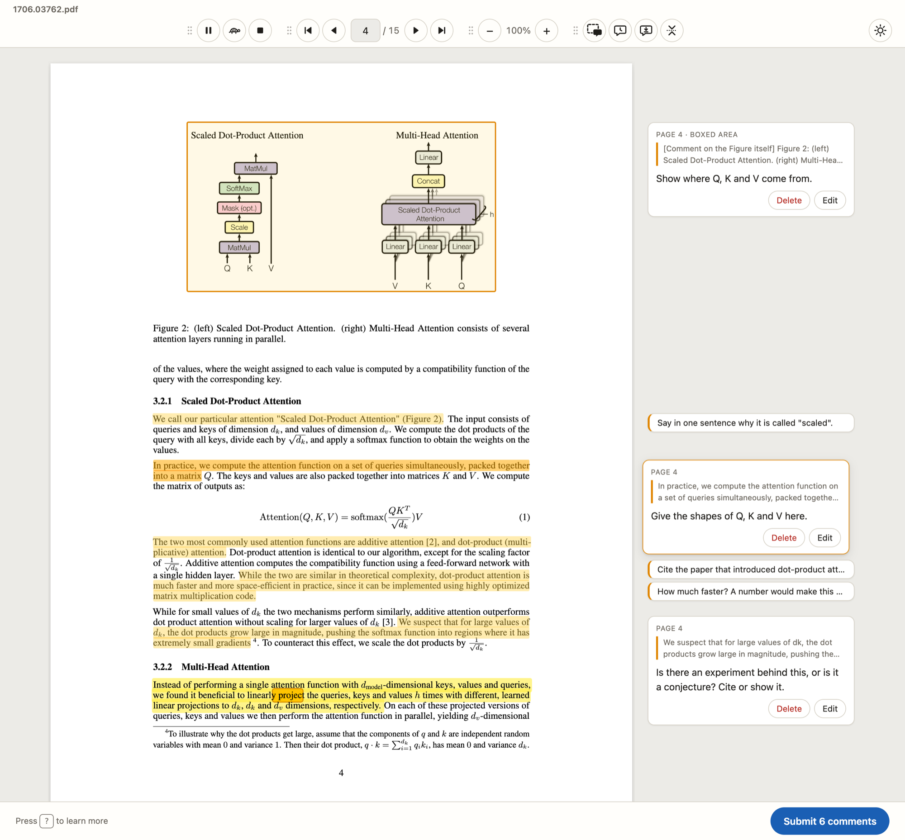

# PDF Human Review

A plugin that lets a person review a PDF in the browser and hand their comments back to the agent that asked.



The review page shows the PDF itself, drawn by PDF.js. The reviewer selects text, or presses the area button and drags a box around a figure, table or equation, and writes a comment in the margin. Comments can be edited and deleted. Pressing **Submit comments** sends them to the agent:

```
Feedback for path/xyz.pdf from human reviewer
> [page 4] the text the reviewer selected
The reviewer's comment

> [page 4] [Comment on the Figure itself] Figure 2: the caption (image of the boxed area: /tmp/pdf-human-review/xyz-1a2b3c4d/region-1.png)
The reviewer's comment on the figure
```

The plugin stops there. Finding the passage in a LaTeX source, editing and recompiling are left to the calling agent.

## Install

The skill in `skills/pdf-human-review/` is in the shared agent-skill format, and its scripts are plain Python. Each agent finds it through its own manifest in this repository. The Claude Code and Codex installs have been tested from GitHub. The commands for Antigravity and Cursor follow each agent's documentation and have not been tried.

### Claude Code

```bash
claude plugin marketplace add delip/pdf-human-review
```

```bash
claude plugin install pdf-human-review@pdf-human-review
```

To install from a local checkout instead, for example while developing, give the first command the folder's path: `claude plugin marketplace add /path/to/pdf-human-review`.

### Codex

Add this repository as a plugin marketplace. Codex reads `.agents/plugins/marketplace.json` from it.

```bash
codex plugin marketplace add delip/pdf-human-review
```

```bash
codex plugin add pdf-human-review@pdf-human-review
```

You can also install it from the plugin list: run `/plugins` in the Codex CLI, or open Plugins in the Codex app.

### Antigravity

```bash
agy plugin install https://github.com/delip/pdf-human-review
```

Run the same command again to update.

### Cursor

Cursor has no command for installing a plugin straight from GitHub, so clone the repository into its local plugins folder:

```bash
git clone https://github.com/delip/pdf-human-review ~/.cursor/plugins/local/pdf-human-review
```

Then restart Cursor, or run **Developer: Reload Window**, and check that the skill appears under Customize. Cursor skips symlinks that point outside that folder, so clone or copy the repository there; do not link to a checkout elsewhere.

### Any other agent

Copy the `skills/pdf-human-review/` folder into the agent's skills location.

## Updating

The Claude Code steps have been tested. The others follow each agent's documentation.

### Claude Code

A new release reaches you only when its version number changes. To update by hand:

```bash
claude plugin update pdf-human-review@pdf-human-review
```

To get new releases automatically, turn on auto-update for this marketplace once. It is off by default for marketplaces that are not Anthropic's own.

1. Run `claude` in a terminal and type `/plugin`.
2. Open the **Marketplaces** tab and select `pdf-human-review`.
3. Choose **Enable auto-update**.

Claude Code then checks for a new release shortly after each session starts. A session that is already running keeps the version it loaded, and the next session uses the new one.

### Codex

Refresh the marketplace, then restart Codex:

```bash
codex plugin marketplace upgrade pdf-human-review
```

The upgrade command has been run, but not across a new release, so it is not confirmed that it also updates a plugin that is already installed. If `codex plugin list` still shows the old version afterwards, run `codex plugin add pdf-human-review@pdf-human-review` again.

### Antigravity

Run the install command again:

```bash
agy plugin install https://github.com/delip/pdf-human-review
```

### Cursor

Pull the latest changes into the clone, then restart Cursor or run **Developer: Reload Window**:

```bash
git -C ~/.cursor/plugins/local/pdf-human-review pull
```

### Any other agent

Copy the `skills/pdf-human-review/` folder into the agent's skills location again, replacing the old copy.

## Use

`/pdf-human-review <file.pdf>` starts a review. Saying "I want to do a human review of this PDF" also works, and the agent asks before starting. One PDF is reviewed at a time. There is nothing to set up.

## How it works

| File | Job |
|---|---|
| `skills/pdf-human-review/SKILL.md` | The workflow the agent follows. |
| `scripts/review_server.py` | Builds the page, serves it on `127.0.0.1`, waits for Submit, prints the feedback. `collect` reads the feedback from the working folder or, failing that, from the clipboard. `clean` removes working files. |
| `scripts/build_review.py` | Embeds the PDF in the review page, giving one self-contained HTML file. |
| `assets/review_template.html` | The page and its commenting UI. |

The scripts use only the Python standard library. The page loads PDF.js 3.11 from jsDelivr, so the reviewer's browser needs an internet connection.

If the page cannot reach the local server, Submit copies the feedback to the clipboard, and the agent reads it from there when the reviewer says they have submitted.

## Files and cleanup

Nothing is written into your project. Working files for a review go in a folder for that PDF under the system temporary folder.

- Each review of the same PDF empties the folder first, so rounds of an iterative review do not pile up.
- After Submit the folder holds only `feedback.md`, `feedback.json` and one `region-N.png` per boxed area, which the agent opens to see what was boxed. If the server is stopped before Submit, the folder is removed.
- Folders of other reviews untouched for a week are removed when a new review starts, and the operating system clears its temporary folder as usual.
- `python3 scripts/review_server.py clean` removes everything at once.

## Development

The version number lives in four files, which need changing together on each release:

- `.claude-plugin/plugin.json`
- `.codex-plugin/plugin.json`
- `.antigravity-plugin/plugin.json`
- `.cursor-plugin/plugin.json`
